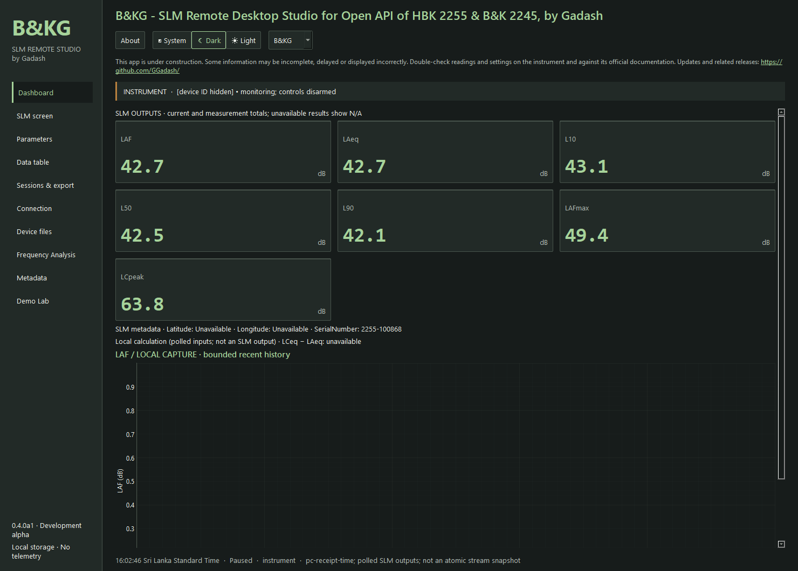
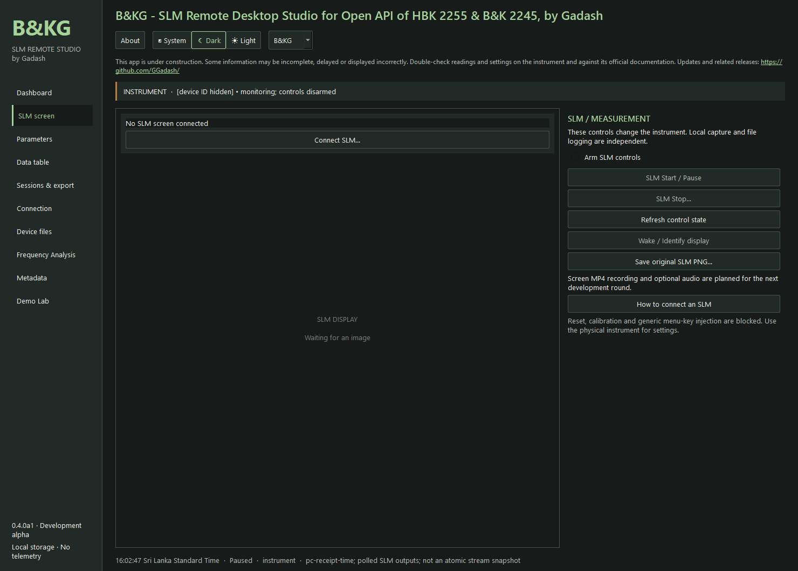
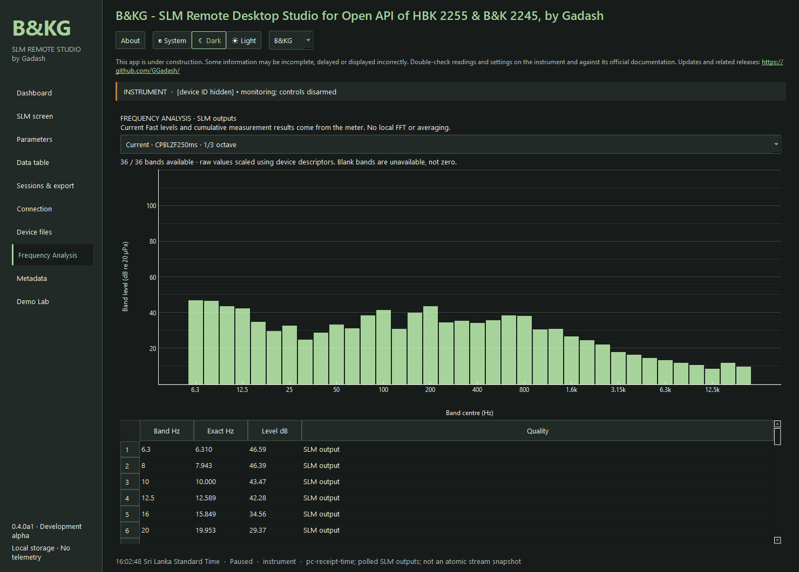
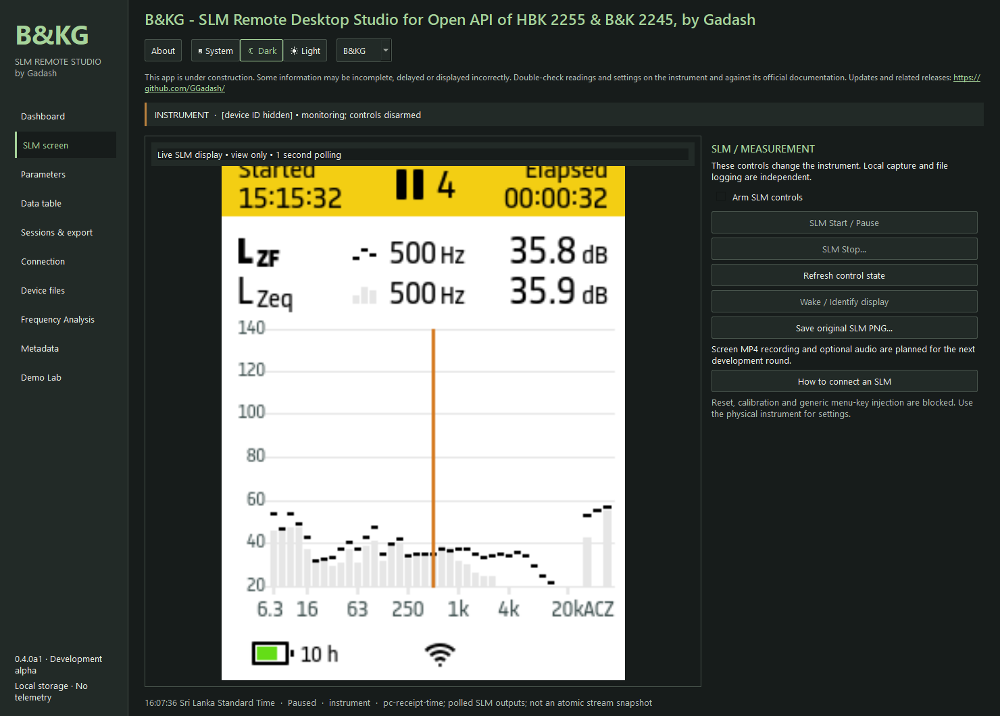
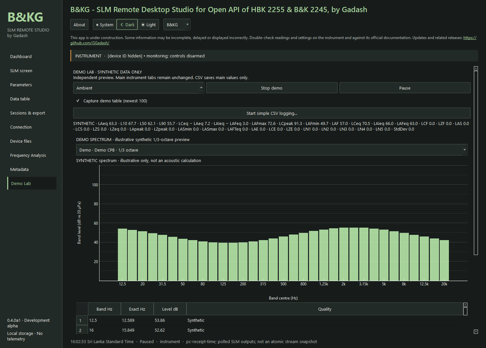
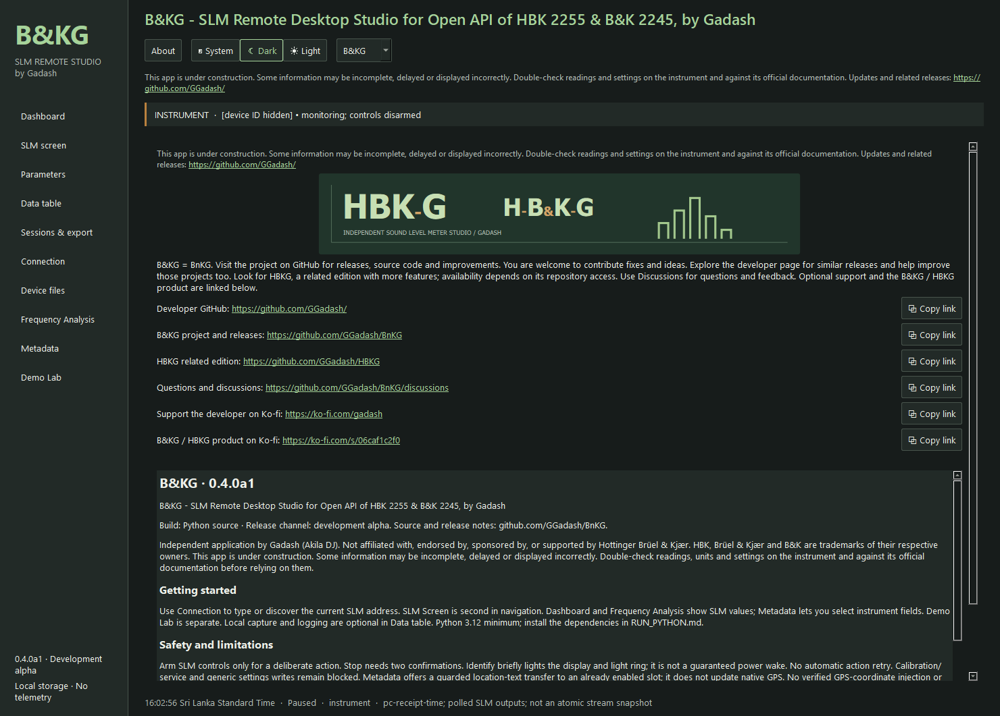

# B&KG · BnKG

**Use at your own risk.** B&KG is under development; information may be incomplete or incorrect. To the extent permitted by applicable law, the developer and distributors are not responsible for data loss, lost measurements or changes to SLM settings arising from use. Read and understand the instructions, check each action and the selected instrument, back up important data, and verify results/settings on the SLM. You may contact B&K/HBK about using third-party apps with your instrument; this does not imply their approval or support.

**SLM Remote Desktop Studio for Open API of HBK 2255 & B&K 2245, by Gadash**

Independent Windows and Linux desktop app, built with Python and Qt. **0.4.0a1 is a development alpha.** This app is under construction: some information may be incomplete, delayed or displayed incorrectly. Double-check readings, units and settings on the instrument and against its official documentation.

[Overall information and credits](README-INFO.md) · [Help index](docs/README.md)

## Download and choose an edition

Get the [latest releases](https://github.com/GGadash/BnKG/releases) and read [which release to get](Readme-info-which-relese-to-get.txt).

| Edition | Python needed? | Best for |
| --- | --- | --- |
| **Executable Portable ZIP** | No | Most Windows x64 users; extract all files and run Launch-BnKG-Portable.cmd |
| **Standalone EXE** | No | One-file convenience; runtime extracts temporarily at launch |
| **Linux Executable Portable tar.gz** | No | Ubuntu 22.04/24.04 x86-64; see [Linux setup](docs/LINUX.md) |
| **Python Portable ZIP** | Yes, x64 3.12–3.14 | Python users and developers; run setup once to install pinned dependencies |

All editions have the same app features. Portable launchers keep user data in a local `data/` folder; direct EXE/Python launch defaults to Windows per-user app-data. Binaries are unsigned. Tested build runtime: Python 3.12.14 x64. Clean-Windows/office-PC and actual-DPI acceptance remain pending.

**Release features:** improved Dashboard/Frequency and saved-file workflows, original-frame screen recording, confirmed-control safeguards, FLAC capture, local audio playback, native AAC/Opus and estimated paired MP4 export, plus a narrowly validated 2255 BKC total reader. [Release notes and limits](docs/RELEASE_NOTES.md). Screenshots below are historical development previews and may differ from the current interface.

## What it does

- Dashboard and parameter views show current/cumulative SLM outputs with descriptor-based units and conversion; unavailable results stay unavailable.
- Frequency Analysis displays supported current and measurement-total CPB spectra as bars and a value table.
- SLM Screen mirrors native PNGs, labels stale/disconnected images and saves the original received image. Identify is a guarded display/light-ring pulse.
- Explicit connection/discovery, optional local bounded capture, full session logging and CSV/XLSX/TXT/TSV/JSON/NDJSON/HTML export.
- Separate **Demo Lab** with three clearly synthetic scenarios and simple CSV saving; demo values never populate instrument views.
- Selectable metadata/health, manual coordinate draft and guarded single text-slot location transfer. Text annotations do not change native GPS.
- Explicit saved-device-file inventory with count/date filters and paged directory browsing. Bounded original-file downloads include a SHA-256 result; limited 2255 native totals and direct A/Z saved spectra are supported; see [BKC decoding](docs/BKC_DECODING.md).
- Dark/light/system appearance, colour themes and clickable/copyable project/support links.

Starts disconnected, with capture/logging off. Device Start/Pause/Stop are separate guarded actions, not local recording controls. Calibration/service and unknown writes are blocked. No automatic retries after an uncertain action. Screen recording, FLAC audio capture, local playback and optional media export are available in current source. A licensed/compatible SLM is needed for real acquisition; 2245 and other firmware still need hardware acceptance.

## Preview screenshots

Actual application captures, PNG format. Live previews use a paused 2255 on firmware 1.3.0.478; current levels can still change. They are examples, not measurement evidence. Demo screenshots are synthetic. Device ID/address text is hidden in the capture UI; no readings were substituted. [All ten screenshots and context](docs/screenshots/README.md).

| Dashboard | SLM level screen |
| --- | --- |
|  |  |

| Frequency Analysis | SLM spectrum |
| --- | --- |
|  |  |

| Demo Lab | About and links |
| --- | --- |
|  |  |

## Guides and participation

[Quick start](QUICK_START.md) · [User guide](docs/USER_GUIDE.md) · [Python setup](RUN_PYTHON.md) · [SLM connection](CONNECTION_GUIDE.md) · [Contents](CONTENT_STRUCTURE.md) · [Build and verify](BUILDING.md) · [Wiki](https://github.com/GGadash/BnKG/wiki) · [Discussions](https://github.com/GGadash/BnKG/discussions)

Visit the [BnKG project](https://github.com/GGadash/BnKG) for source, releases and improvements. Contributions are welcome: use GitHub to report issues, suggest changes and help improve the app. The [developer page](https://github.com/GGadash/) has related releases you can explore and improve too. Look for [HBKG](https://github.com/GGadash/HBKG), a related edition with more features; more developed or different releases may be found there, with separate features and support.

Optional support: [developer on Ko-fi](https://ko-fi.com/gadash) · [B&KG / HBKG product](https://ko-fi.com/s/06caf1c2f0).

## Licence and limitations

Original code/artwork: MIT, © 2026 Gadash (Akila DJ). Created with OpenAI tools including ChatGPT/Codex and the open-source tools credited in About. Independent of Hottinger Brüel & Kjær; no endorsement or measurement/regulatory compliance claim. See [Legal](LEGAL.md), [Privacy](PRIVACY.md), [third-party notices](THIRD_PARTY_NOTICES.md) and [dependency sources/replacement](docs/DEPENDENCY_SOURCES.md). Do not upload private full-project migration ZIPs as public releases.

Optional screen MP4: see [FFmpeg setup](docs/FFMPEG_SETUP.md) for downloads, installation paths, Browse controls and licensing. Original PNG and FLAC capture do not need the external FFmpeg tools. Native AAC/Opus and receipt-aligned paired MP4 export use them.

Instrument audio is available in the source app: [FLAC capture, confirmations and limits](docs/AUDIO_CAPTURE.md). See the release notes for package validation and remaining acceptance gaps.

This software uses FFmpeg playback libraries under LGPL-2.1-or-later; their corresponding source is available with the [release downloads](https://github.com/GGadash/BnKG/releases). See [credits](CREDITS.md) and [source/build details](docs/DEPENDENCY_SOURCES.md).

[Wiki screenshot gallery with clickable thumbnails](https://github.com/GGadash/BnKG/wiki/Screenshots) · [Original PNG previews](https://github.com/GGadash/BnKG/tree/main/docs/screenshots).
