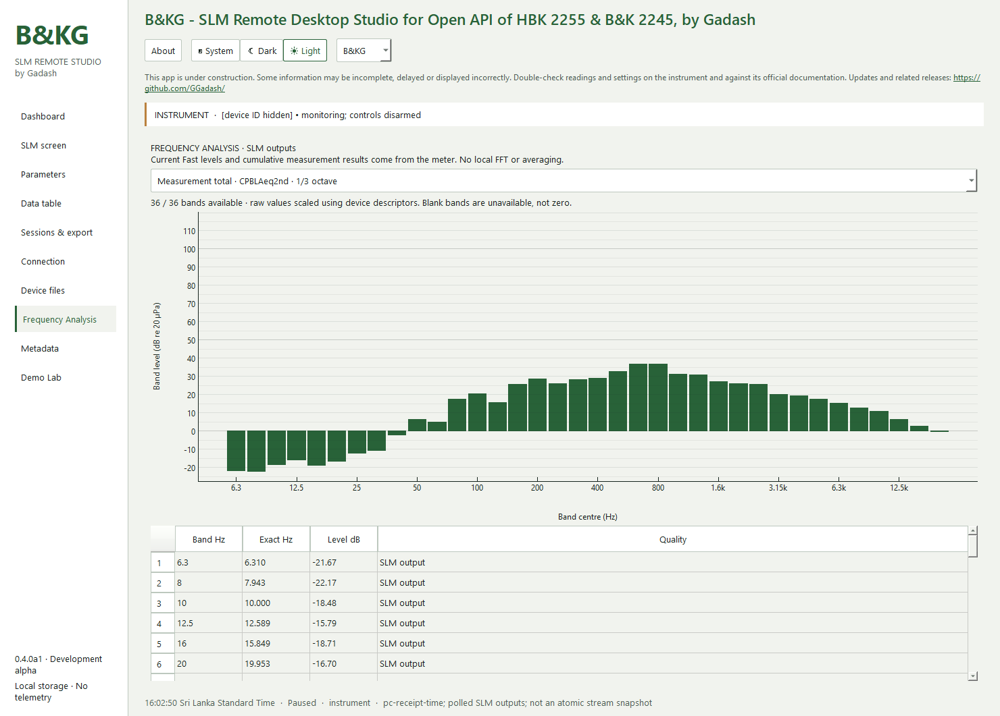
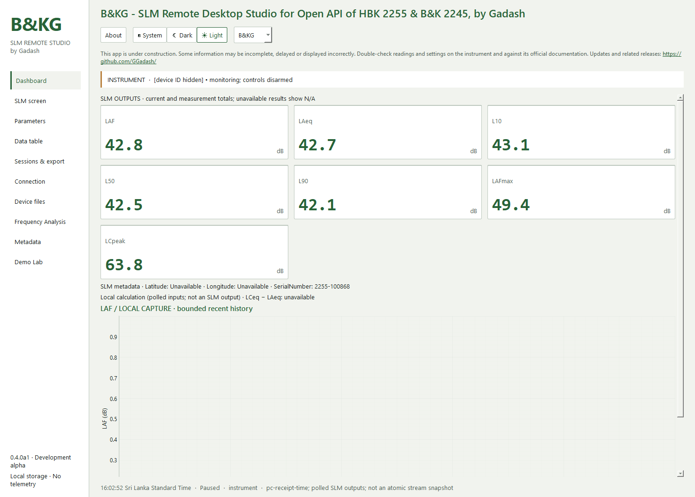
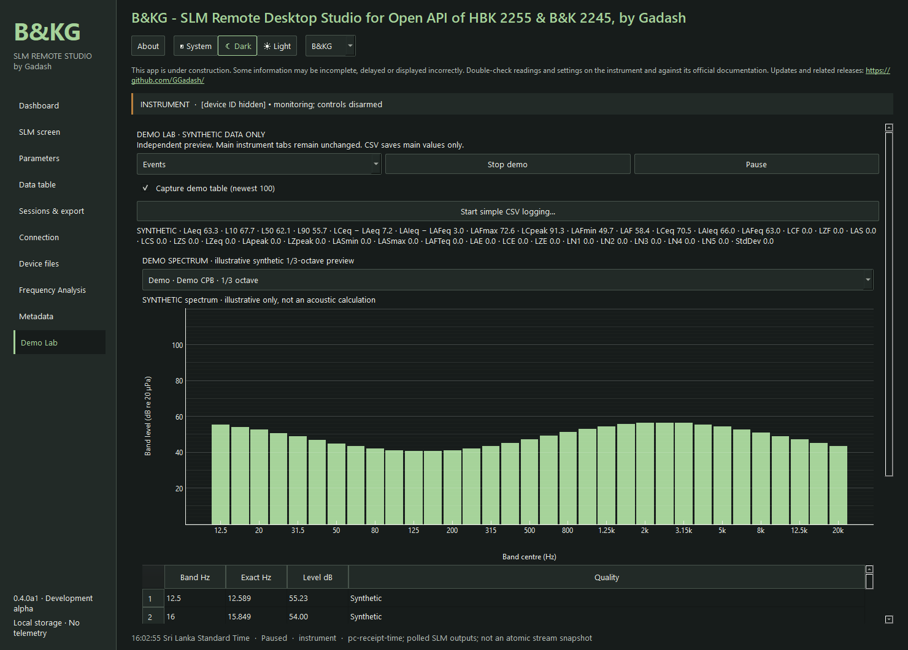
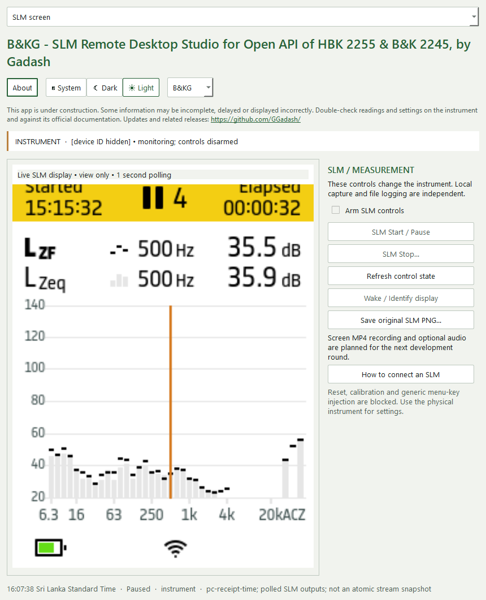

# Preview screenshots

Ten native PNG captures from B&KG 0.4.0a1. Live views use a paused HBK 2255 on firmware 1.3.0.478. Current levels may update while measurement totals remain paused. Demo images are synthetic. These images are illustrative, not calibration or regulatory evidence. Device ID/address labels were hidden in the capture UI; no readings were replaced.

Identify and single Up/Down actions were explicitly authorized and sent through the safety layer, with state read-back and no retries after an uncertain write. One pre-action identity GET timed out; no action was sent in that failed attempt. A subsequent read-only check restored reachability. Measurement state remained Paused throughout successful navigation. No Start/Pause/Stop, menu, calibration or metadata write was used.

## Dashboard, dark theme; real instrument outputs.

## SLM level summary after the supervised Up arrow.

## Current instrument CPB frequency spectrum.

## Measurement-total CPB spectrum; light theme.

## Dashboard, light theme.

## Demo Lab Ambient; synthetic data.

## Demo Lab Events; synthetic data.

## About warning, credits and clickable/copyable links.

## SLM spectrum after supervised Down navigation.

## Narrow SLM screen layout; light theme.

